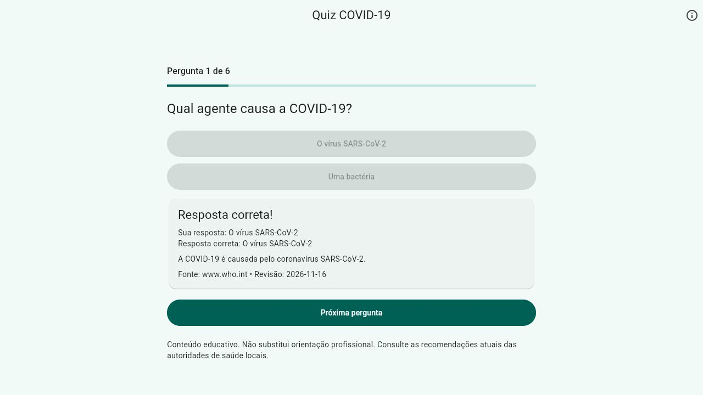

# Quiz COVID-19

[](https://github.com/kleberandrade/quiz-covid19-flutter/actions/workflows/ci.yml)
[](https://docs.flutter.dev/)
[](https://dart.dev/)
[](#requirements)
[](LICENSE)

An offline educational COVID-19 quiz built with Flutter. Answer six questions in Brazilian Portuguese, review explanations and their official sources, see your score, and start again. Answers, progress and scores stay on the device for the current session. There are no accounts, ads, remote question services or analytics.

Created in 2020 by **Kleber de Oliveira Andrade** for a Mobile Programming course. Version 2 modernizes the original teaching exercise with null safety, a local reviewed question bank, accessible Material controls and behavior tests. The [original tutorial](https://medium.com/@kleberandrade/desenvolvendo-um-quiz-com-flutter-e-google-sheets-414656cb89a2) documents the historical implementation; its Google Sheets integration is no longer used.

This app is educational, not medical advice or a diagnostic tool. Content was checked against an official WHO source on **2026-11-16**. Consult current local health guidance. See [content provenance and maintenance](docs/CONTENT.md).



## Requirements

- **Flutter 3.50.0 stable / Dart 3.14.0**, pinned in `.flutter-version`. Install through the [official SDK archive](https://docs.flutter.dev/install/archive). Dart is bundled with Flutter.
- **Web:** a current Flutter-supported browser and a local or hosted HTTP(S) server.
- **Android:** Android SDK 36, JDK 21 for the pinned Gradle build, required SDK/NDK components and accepted Android SDK licenses. Minimum Android API 24.
- **iOS:** macOS, compatible Xcode and iOS 15 or newer. Simulator compilation does not require distribution signing.

Run `flutter doctor -v` to check your machine. This repository does not configure desktop targets. See [validation results and limitations](docs/VALIDATION.md) before relying on a target.

## Quick start

```sh
git clone https://github.com/kleberandrade/quiz-covid19-flutter.git
cd quiz-covid19-flutter
flutter --version
flutter pub get --enforce-lockfile
flutter devices
flutter run -d chrome
```

For Android or iOS, start an emulator/simulator or connect a device, then use `flutter run -d <device-id>` with an ID from `flutter devices`.

Choose an answer once. Feedback shows your choice, the correct answer, an explanation and its review date. Select **Próxima pergunta**, then **Ver resultado** after the last question. **Jogar novamente** resets the attempt. The information button opens **Fontes e informações**; source URLs can be selected/copied and software licenses can be viewed there.

Buttons support keyboard interaction and screen readers, feedback includes text rather than color alone, and content scrolls at larger text sizes. Automated accessibility checks cover labels and minimum tap targets; real assistive-technology testing remains necessary.

## Customize the quiz

Edit `lib/data/question_bank.dart` or pass a nonempty `List<Question>` to `QuizApp`. A complete runnable example is provided:

```sh
flutter run -t example/main.dart -d chrome
```

Each question requires a stable ID, prompt, at least two distinct nonblank options, a zero-based `correctIndex`, explanation, HTTPS source URL and valid `YYYY-MM-DD` review date. The constructor validates these fields and copies the options. Use [the example](example/main.dart) and [content maintenance guide](docs/CONTENT.md) when adding questions. Changing health content requires checking the cited official source again.

The pure Dart `QuizSession` API provides `answer(index)`, `isCorrect`, `advance()`, `restart()`, `score`, `progress` and `isComplete`. `answer` returns whether a selection was accepted. Each question scores at most once, and advancement requires an answer. See [migration details](docs/MIGRATION.md) for the previous API.

## Project layout

```text
lib/
  main.dart                 Entry point and font license registration
  app.dart                  Theme, localization and app composition
  domain/                   Question validation and quiz rules
  data/                     Offline question bank and review date
  presentation/             Quiz, results and information screens
assets/fonts/               Bundled fonts and their license
example/main.dart           Runnable custom quiz
test/                      Domain and widget behavior tests
android/  ios/  web/         Platform projects
.github/workflows/ci.yml    Checks and compilation on Linux/macOS
docs/                      Content, migration, notices and validation log
```

## Checks and builds

```sh
flutter pub get --enforce-lockfile
dart format --output=none --set-exit-if-changed lib test example
flutter analyze --fatal-infos
flutter test --coverage
flutter build web --release --no-web-resources-cdn
flutter build apk --debug
flutter build ios --simulator --debug
```

Coverage is written to `coverage/lcov.info`. Unit tests cover scoring, invalid inputs, progression, completion, immutable data and restarting; widget tests cover the complete quiz, wrong/correct feedback, source navigation and large text.

The CI workflow runs these checks on the pinned SDK, compiling web and Android on Ubuntu and iOS simulator on macOS. Actions are pinned to reviewed revisions and Dependabot checks packages/actions monthly. The badge reflects GitHub's real workflow status after this work is pushed; no passing status or coverage badge is manufactured. Local results are in [VALIDATION.md](docs/VALIDATION.md).

Web output is in `build/web`. To preview it:

```sh
python3 -m http.server 8080 --directory build/web
```

Open [localhost:8080](http://localhost:8080). The documented build embeds rendering resources and bundled fonts, so the quiz does not need external question, font or renderer services. A browser still needs the served files; offline PWA caching is not implemented. Native apps bundle the quiz and work offline after installation.

## Migration and distribution

Read [MIGRATION.md](docs/MIGRATION.md) before integrating old code or publishing an update. Android's existing application ID and iOS's existing bundle ID are preserved. Private signing configuration is excluded; configure release signing and review store requirements separately. The original tracked signing properties were removed from the current tree, but historical credentials should be rotated if still in use.

No build, app store release or package is published automatically. Push and distribution require separate authorization. Medical review, physical devices, screen readers and store signing have not been validated merely by compiling the app. Scores are not persisted, question order is fixed and the interface is Portuguese only.

## License and credits

[MIT](LICENSE), retaining Copyright 2020 Kleber de Oliveira Andrade. [Third-party notices](docs/THIRD_PARTY.md) cover bundled fonts, framework/package assets and linked WHO material. Source organizations do not endorse this app. The [work log](docs/WORK_LOG.md) records changes and their reasons.
